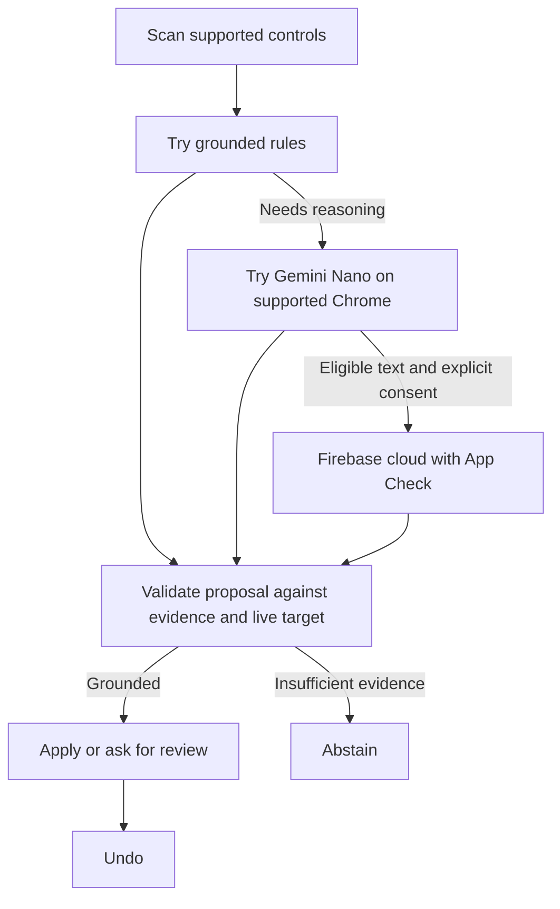

# ClearCue

ClearCue helps screen-reader users understand a control and recover when a webpage leaves them stuck.

- **Smart Repair.** Give a supported unnamed control a grounded accessible name. Check the result with your screen reader and Undo if needed.
- **Context Lens.** Press **Alt+Shift+L** to hear what the focused control does, including supported choices and section context.
- **Interaction Recovery.** Hear a visible error or confirmation a page failed to announce. Jump to the relevant field when ClearCue can identify it.

## Quickstart

Use Node.js 20.19 or later and Chrome 139 or later. Run these commands from a fresh source checkout.

```sh
npm ci
npm run build:release
npm run playground
```

1. Open `chrome://extensions`, enable **Developer mode**, choose **Load unpacked**, and select `dist/`. With the public ZIP, extract it and select the extracted directory instead.
2. Open the [recovery lab](http://127.0.0.1:4318/recovery.html), choose ClearCue from the Chrome toolbar, select **Enable on this site**, and approve access to the loopback origin.
3. In **Repair engine**, choose **Rules only** to repair the unnamed scholarship Help button. Check the name, then use **Undo** in Repair history.
4. In the fictional scholarship form, submit `BAD` and `candidate@example.test`. Review the error in **Interaction recovery**, choose **Jump to affected field**, then enter `NF-12345` and submit again.
5. Use [the member portal](http://127.0.0.1:4318/member-portal.html) to distinguish similarly named search controls. **Open guided practice** in onboarding opens the bundled typed navigation exercise.

The [practice guide](http://127.0.0.1:4318/testing-guide.html) links the repair, navigation and recovery fixtures.

## Hybrid inference



The clean build provides deterministic assistance offline. The configured hybrid build is compiled privately with Firebase and App Check. Visual evidence and contextual reranking are forced on-device. The panel reports the source actually returned by the SDK.

| Path | Role |
| --- | --- |
| [Inference engine](src/inference/engine.ts) | Firebase AI Logic SDK, runtime generation and response provenance |
| [Repair pipeline](src/repair/pipeline.ts) | Rules, forced local and consented cloud modes, and abstention |
| [Prompts](src/repair/prompts.ts) and [privacy policy](src/shared/privacy.ts) | Bounded evidence and cloud consent |
| [Validator](src/repair/validation.ts) and [repair application](src/content/repair/) | Independent grounding, live target checks, application and Undo |

## Evidence and limits

The configured build has completed a genuine Firebase cloud repair and exact Undo. The offline scholarship fixture exercises navigation, silent error detection and recovery without external traffic. In frozen ClearBench v1, rules correctly named two of four planted controls, abstained on two and made zero unsafe writes. [Evaluation evidence](docs/evidence/RELEASE_VERIFICATION.md) · [ClearBench](docs/CLEARBENCH_REPORT.md)

Typed Navigator, guided follow-ups, the Page Map and form requirements support the three core workflows. ClearCue moves focus on request. You decide what to click, enter or submit. Page goals, images and recovery stay local. Eligible cloud repairs use bounded text after consent.

Historical Nano diagnostics confirmed on-device execution. Current accepted Nano repair, visual inference and offline Nano are pending owner verification. The benchmark uses controlled fixtures and measures no population-level impact. [Judge setup](docs/STAGE7_RELEASE.md#judge-testing-with-firebase) · [Architecture](docs/ARCHITECTURE.md) · [Limitations](docs/LIMITATIONS.md)

[Apache-2.0 license](LICENSE) · [Third-party notices](THIRD_PARTY_NOTICES.md)
